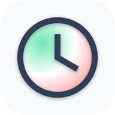

# GameMonitor（Android 版 · 第一阶段 MVP）



本机游戏/应用时长管控，全部在手机端配置，无 Web 控制台。

- 包名：`com.gamemonitor.android`
- 版本：`0.1.5`（versionCode `15`）
- 设备所有者组件：`com.gamemonitor.android/.service.MonitorDeviceAdminReceiver`
- minSdk 29（Android 10）/ targetSdk 35（Android 15）

## 1. 安装 APK

```powershell
adb install -r "D:\Project\Trae_Work\GameMonitorAndroid\app\build\outputs\apk\debug\app-debug.apk"
```

也可以直接把 `app-debug.apk` 拷到手机点击安装（需允许“未知来源”）。首次打开会自动启动前台监控服务，并申请通知权限。

## 2. 权限（按能力分级，从高到低）

### 2.1 设备所有者（L3，最高优先级，静默挂起）

要求：设备未添加任何账号（Google/厂商账号）、未设置工作资料；通常需要新机或恢复出厂后执行。

```powershell
adb shell dpm set-device-owner com.gamemonitor.android/.service.MonitorDeviceAdminReceiver
```

成功返回 `Success: Device owner set to package ...`。之后应用在时长到 / 禁止时段调用
`DevicePolicyManager.setPackagesSuspended()` 静默挂起目标应用，不可打开；限制解除（休息期结束、次日、时段放行）时自动解除挂起。

解除设备所有者（卸载前必须先执行，否则无法卸载）：

```powershell
adb shell dpm remove-active-admin com.gamemonitor.android/.service.MonitorDeviceAdminReceiver
```

无法设置设备所有者时（多数已登录账号的日常用机），走下面的兜底方案。

### 2.2 使用情况访问（必需）

设置 → 应用 → 特殊应用权限 → 使用情况访问 → 允许 GameMonitor。没有它无法读取前台应用，计时与拦截都不生效。

### 2.3 无障碍服务（L2 兜底拦截）

设置 → 无障碍 → 已下载的应用 → GameMonitor → 开启。
用途：`GLOBAL_ACTION_HOME` 返回桌面。
无障碍事件已严格收窄：只接收系统设置类包名（`packageNames` 白名单）的窗口状态变化，不使用 `flagRetrieveInteractiveWindows`，
不监听其他应用窗口；只有在设置里手动开启「自动点击强行停止」后，才会在本应用自己打开的应用详情页内点击一次（最长 15 秒后放弃）。

### 2.4 悬浮窗（L2/L1 提示层）

设置 → 应用 → 特殊应用权限 → 显示在其他应用上层 → 允许 GameMonitor。
用途：全屏倒计时、休息期与禁止时段浮层。

### 2.5 电池优化 / 自启动

- 电池优化：设置 → 应用 → GameMonitor → 电池 → 不受限制。
- 自启动：系统自带的“自启动/后台管理”里允许 GameMonitor（已注册 `BOOT_COMPLETED`）。

> 应用内「权限」页会逐项显示当前状态，并提供跳转/复制 adb 命令按钮，可在这里核对以上所有项。

### 2.6 管理密码与隐藏桌面图标（家长控制）

管理密码（PIN，4~8 位数字）在「权限」页设置，使用 SHA-256 + 随机盐保存，不落明文；连续输错 3 次锁定 30 秒（锁定时间持久化，重启 App 不解除）。
默认开启「进入设置页（权限 Tab）需要密码」，避免孩子直接改管控参数。

**全局入口锁（与图标是否隐藏无关）**

只要设置过管理密码，**任何入口**（桌面图标、常驻通知正文/「管理」、桌面快捷方式）打开 `MainActivity` 都必须先验证密码；密码正确仅在当前前台会话有效，切到后台（`onStop`）即重新锁定，回来需再次输入。不存在“进过一次通知就一直免密”的窗口。

**隐藏图标（前置条件：必须已设置管理密码）**

1. 长按桌面 GameMonitor 图标 → 快捷方式「隐藏图标」→ 应用校验已设置管理密码后才执行隐藏（未设置时只提示「请先在设置中设置管理密码」，绝不执行）。
2. 隐藏使用 `activity-alias`（`com.gamemonitor.android.LauncherAlias`）承载 `LAUNCHER`，通过 `PackageManager.setComponentEnabledSetting(DISABLED, DONT_KILL_APP)` 生效；
   主界面 `MainActivity` 已设置 `android:excludeFromRecents="true"` + `singleTask`，不会出现在最近任务里。
3. 隐藏后常驻通知文案保持中性（标题「游戏监控运行中」），**不出现“恢复图标”字样**，只多一个中性标签的 action「管理」；
   点击通知正文或「管理」都会进入 `MainActivity` 的密码门；验证通过后进入管理界面。**该入口不会改变图标的隐藏状态**。

**恢复图标（唯一入口：应用内「权限」页，且需管理密码）**

- 通知栏「管理」只负责进入 App，不再直接恢复图标；隐藏状态跟随用户操作，不会被“进过一次通知”改掉。
- 应用内：过全局密码门 → 「权限」页（默认再验一次密码）→ 点「恢复图标」按钮（日志 `GameMonitor.Launcher`）。
- PIN 页没有“忘记密码 / 跳过”后门，取消即退出。

**adb 兜底恢复（通知被清理 / 系统限制通知时）**

```powershell
adb shell pm enable com.gamemonitor.android/.LauncherAlias
```

**边界情况**

- 无论图标是否隐藏，只要设置过管理密码，从任何入口启动 App 都会先过密码门；切出后回来会重新锁定。
- 图标隐藏状态只由「权限」页的隐藏/恢复按钮与桌面快捷方式「隐藏图标」改变（后者同样先验证密码）。
- 清除应用数据（DataStore 被清空）或卸载重装会丢失管理密码与全部配置；此时若图标仍是隐藏状态，只能用上面的 adb 命令恢复。
- 不要关闭本应用的通知权限：隐藏图标后，通知「管理」是唯一的图形化**进入**入口。
- 恢复动作只有应用内「权限」页「恢复图标」按钮；通知/桌面图标都只负责进入应用，且必须先过管理密码。图形入口都失效时用上面的 adb 命令。

## 3. 功能配置位置（底部五个 Tab）

| Tab | 作用 |
| --- | --- |
| 条目 | 添加/删除监控应用（仅列出可启动的第三方应用，排除系统应用与自身）；设置单次时长、每日配额、休息间隔、启用开关；上移/下移调整顺序；对单个条目「加时」（默认 30 分钟，1–720 分钟）；顶部可启停监控服务并查看当前前台应用 |
| 时段 | 新增/编辑“禁止时段”“开放时段”，选择起止时间与周几（多选），支持跨零点（结束时间早于开始时间） |
| 统计 | 每个应用今日已用、次数、首次开启/末次关闭；今日总用时与每日总限额 |
| 样式 | 每日总限额、倒计时秒数（0=立即拦截）；三类文案（倒计时/休息期/禁止时段）与占位符 `{app}` `{minutes}` `{seconds}` `{clock}`；字号、文字颜色、背景不透明度；“自动点击强行停止”开关（默认关闭） |
| 权限 | 权限状态总览、当前实际管控等级、各权限跳转、设备所有者 adb 命令、管理密码设置、隐藏/恢复桌面图标与 adb 恢复命令 |

## 4. 分级拦截的实际行为

| 条件 | 行为 |
| --- | --- |
| 设备所有者已授权 | L3：到点直接 `setPackagesSuspended` 静默挂起，无浮层；发一条通知；限制解除自动解挂 |
| 无设备所有者 + 无障碍 + 悬浮窗 | L2：单次到点直接进入全屏倒计时 → 倒计时结束返回桌面；返回桌面失败时尝试打开应用详情页并点击“强行停止” |
| 无设备所有者 + 仅悬浮窗 | L1：只显示浮层提示（4 秒后自动消失，避免锁死），无法强制退出 |
| 都没有（仅通知） | L0：只发通知提醒，明确当前无管控权限 |

## 5. 构建

本机工具链（已安装到非系统盘）：

- JDK：`D:\Development\jdk-21`（Temurin 21.0.13）
- Android SDK：`D:\Development\android-sdk`（platform-tools 37.0.1、build-tools 35.0.0、platforms;android-35）
- Gradle：`D:\Development\gradle`（8.11.1），工程内也已生成 wrapper

命令行构建（`local.properties` 已写入 `sdk.dir`）：

```powershell
$env:JAVA_HOME="D:\Development\jdk-21"
$env:ANDROID_HOME="D:\Development\android-sdk"
cd D:\Project\Trae_Work\GameMonitorAndroid
D:\Development\gradle\bin\gradle.bat --no-daemon assembleDebug
```

> 工程路径说明：本工程原先位于 `T:\Amateur_Project\Trae\GameMonitor-Android`（SMB 映射盘），已迁移到 `D:\Project\Trae_Work\GameMonitorAndroid`；旧路径的脚本/文档请按新路径替换。

## 6. 工程结构

```
app/src/main/java/com/gamemonitor/android/
├── data/        Models.kt（条目/规则/用量/设置）、GameRepository.kt（DataStore+JSON）、TimeUtils.kt、
│                SecurityRepository.kt（管理密码 DataStore）、PinManager.kt（PIN 校验/锁定）
├── domain/      MonitorEngine.kt（状态机）、MonitorState.kt、ScheduleMatcher.kt、InstalledAppsProvider.kt
├── service/     MonitorService.kt（前台 1s tick）、ForegroundDetector.kt、GameAccessibilityService.kt、
│                EnforcementManager.kt、OverlayController.kt、Notifier.kt、LauncherIconController.kt、
│                MonitorDeviceAdminReceiver.kt、BootReceiver.kt
└── ui/          AppRoot.kt + AppsScreen / ScheduleScreen / StatsScreen / TextSettingsScreen /
                 PermissionsScreen / PinGateScreen
```

状态机：`IDLE → RUNNING → COUNTING_DOWN（倒计时）→ COOLDOWN（休息期）/ QUOTA_EXHAUSTED`，
时段命中为 `BLOCKED_BY_SCHEDULE`；切出应用暂停累计，但已进入的倒计时按绝对时间继续，切回显示真实剩余。
管理端加时只抬高当前轮次的上限（单次上限与当日配额阈值），不另建计时来源。

## 7. 已知限制（第一阶段）

- 已在真机上完成实测：安装与升级、计时与拦截、悬浮窗、无障碍返回桌面、设备所有者挂起、隐藏 / 恢复桌面图标、管理密码流程均正常，当前没有发现问题。
- 前台检测依赖 `UsageStatsManager` 的 `ACTIVITY_RESUMED/PAUSED` 事件；Android 10+ 对事件的粒度受系统限制，秒级精度会有 ±1 tick 误差。
- 「加时」是当前轮次的内存态：监控服务重启（含强行停止、重启手机）后失效；不会改写当日统计用量。
- 计时用 1 秒前台 tick，不依赖 `AlarmManager`，因此未声明 `SCHEDULE_EXACT_ALARM` / `USE_EXACT_ALARM`。
- 条目顺序已持久化并参与列表排序，但在“单前台应用”模型下不改变拦截判定（没有多规则合并场景）。
- 设备所有者模式下挂起的应用图标会置灰，系统提示“应用已暂停”；这是系统行为。
- 无设备所有者且无无障碍时只能提示，不能真正阻止继续使用。
- 桌面图标的隐藏 / 恢复依赖 `activity-alias` 的启用状态；个别第三方桌面有图标缓存，刷新可能有延迟。
- 悬浮层（含全屏倒计时）均为 `FLAG_NOT_TOUCHABLE | FLAG_NOT_FOCUSABLE`，只做展示，不再拦截触摸；因此倒计时期间仍可滑动屏幕，拦截完全依靠返回桌面或设备所有者挂起。

## 感谢打赏


如果这个小工具确实帮你省下了一点游戏时间，欢迎请我喝杯咖啡。你的支持是持续更新的动力，谢谢。

## 许可证

本项目采用 [MIT License](LICENSE)。
